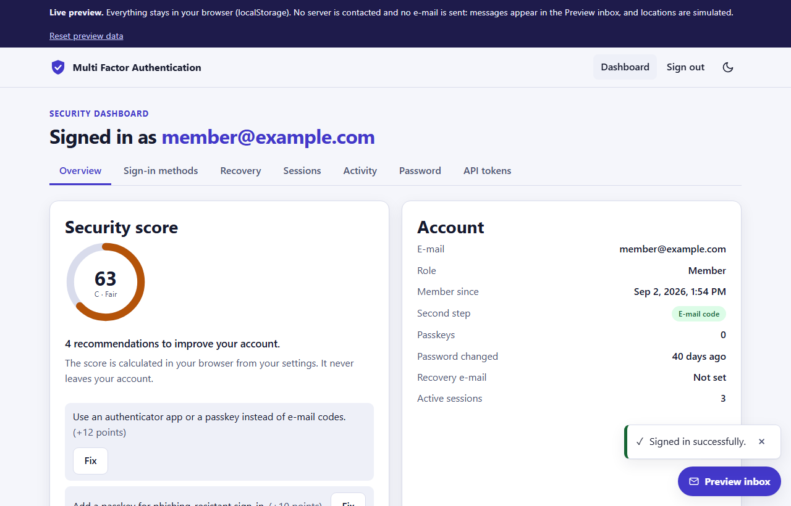

# Multi Factor Authentication

**Live preview (runs entirely in your browser, no server):** https://shishir19999.github.io/Multi-Factor-Authentication/

A complete account-security product: e-mail + password sign-in with a second step (e-mailed one-time code, authenticator app, or a **passkey**), backup and recovery options, step-up re-authentication, "was this you?" alerts for new devices, a security score with recommendations, session and device control, personal API tokens, and an **admin console** (users, lock/unlock, forced resets, audit log with CSV export, configurable security policy).

**Stack:** React 19 + Vite 8 (Frontend), Express 5 + Mongoose 9 + Nodemailer + bcrypt + `@simplewebauthn/server` (Backend). Node 24 LTS or newer.



## Features

**Signing in**
- Registration and sign-in with a live strength meter and a rules checklist that follows the active security policy.
- Second step: e-mailed 6-digit code (5 minute expiry, attempt limit, resend cooldown), authenticator app (TOTP, RFC 6238, QR code), or a passkey (WebAuthn, user verification required). A passkey can also sign you in with no password at all.
- Ten single-use backup codes (download, print, copy), trusted devices (configurable days, revocable).
- Accessible code entry: six boxes with per-digit labels, paste, auto-advance, arrow keys, one-time-code autofill and a spoken instruction.

**Protection**
- Step-up re-authentication: sensitive actions (change factors, passkeys, API tokens, exports, recovery e-mail, every admin action) require a confirmation within the last few minutes, by password, authenticator code or passkey. The dialog appears automatically and the action is retried.
- Lockout with progressive durations and rate limits with **visible countdowns** (sign-in, codes, recovery, sensitive actions).
- Optional breached-password check against Have I Been Pwned using k-anonymity (only the first 5 characters of the SHA-1 hash are sent; if the service is unreachable the password is accepted).
- Password history, password expiry, forced reset, "must enrol 2FA" flags and a policy that can require a second step for everyone or only administrators.
- New device / unusual location alerts: an e-mail with one-tap **Yes, it was me** / **No, secure my account** (the latter signs out everything and forces a new password), also shown on the dashboard.
- Security score (0 to 100) with ranked recommendations; recovery readiness checklist.

**Recovery**
- Recovery code by e-mail (also sent to a verified secondary recovery e-mail), backup codes, and **administrator-assisted recovery** (a help request the admin answers with a recovery code or a 2FA reset).

**Visibility and control**
- Sessions list with device names (renameable), approximate place, how you signed in, last seen; revoke one, all others, or everywhere.
- Account activity with filters, exportable as CSV or JSON.
- Personal API tokens: hashed at rest, scoped, read-only, expiring, revocable, with a built-in "try a token" box.

**Admin console** (role Administrator): statistics and a 7-day chart, user list with search/role/status/help-request filters, per-user actions, audit log with filters, pagination and CSV export (formula-injection safe), and the security policy editor (required factors, password rules, breach check, session lifetime, idle timeout, step-up window, lockout thresholds, trusted-device days, alerts) plus a "send test e-mail" button.

**Interface:** light/dark theme (follows the OS), responsive from 320 px, keyboard operable (skip link, roving-tab tablists, focus-trapped dialogs), screen-reader friendly (live regions, labelled controls, no colour-only signals). Parallax and scroll-reveal exist **only on the landing page**; they use transform/opacity, honour `prefers-reduced-motion`, and switch off on small or low-power devices.

## Roles

| Capability | Member | Administrator |
|---|---|---|
| Sign-in methods, passkeys, backup codes, trusted devices | yes | yes |
| Sessions, activity (+ export), recovery options, API tokens, password | yes | yes |
| Security score and "was this you?" alerts | yes | yes |
| Admin console: users, lock/unlock, force reset, force 2FA, reset 2FA, revoke sessions, change roles, issue recovery codes | no | yes |
| Audit log (+ CSV) | own activity only | all accounts |
| Security policy and test e-mail | no | yes |

The first administrator is set with `ADMIN_EMAIL` (promotes that account at start-up, or creates it when `ADMIN_PASSWORD` is also set). Administrators cannot lock or demote themselves, and the last administrator cannot be demoted.

## Live preview vs. real mode

Both modes expose the same screens and features and share the same rule code (`Backend/shared`, copied to `Frontend/src/shared`): policy engine, lockout, rate-limit windows, risk assessment, score, audit catalogue and CSV, breach check, token scopes.

| | Real mode (Express + MongoDB) | Live preview (GitHub Pages) |
|---|---|---|
| Server | Express API, MongoDB | A simulation inside the browser, data in `localStorage` |
| Passwords | bcrypt | PBKDF2 (WebCrypto) |
| Session | HttpOnly `SameSite` cookie + CSRF token | Opaque id in `localStorage` (no network, so no CSRF surface) |
| E-mail | Gmail SMTP (or any SMTP) | The labelled **Preview inbox** panel shows every code and link |
| Location | `CF-IPCountry`-style proxy header, else "Local network"/"Unknown" | **Simulated** from a fake address; a selector lets you pretend to sign in from another device or city |
| Passkeys | Real WebAuthn verified by `@simplewebauthn/server` | Real browser WebAuthn, verified by an in-browser re-implementation of the server checks; if the browser has no WebAuthn (or you tick the box) a clearly labelled software authenticator stands in |
| Breach check | Server + browser lookups | Browser lookup (needs internet; fails open) |

### Sample accounts (Live preview and `npm run seed`, sample data only)

Password for all: `Sample@12345`

| E-mail | Role | Second step |
|---|---|---|
| `member@example.com` | Member | E-mail code (read it in the Preview inbox) |
| `alice@example.com` | Member | Authenticator app (live code shown on the sign-in page, secret `JBSWY3DPEHPK3PXP`, backup code `abcde-fghjk`) |
| `bob@example.com` | Member | None |
| `admin@example.com` | Administrator | E-mail code |

Run the preview locally:
```bash
cd Frontend
npm install
VITE_DEMO=true npm run dev      # PowerShell: $env:VITE_DEMO='true'; npm run dev
npm run build:pages             # static site in Frontend/dist (base /Multi-Factor-Authentication/, hash routing)
```
Use **Reset preview data** in the banner to start over.

## Setup (real mode)

```bash
# Backend
cd Backend
cp .env.example .env     # fill in MongoDB, JWT_SECRET, SMTP and the first admin
npm install
npm run seed             # optional sample accounts (database "mfa")
npm start                # or: npm run dev

# Frontend
cd Frontend
cp .env.example .env     # VITE_API_URL must point to the backend
npm install
npm run dev
```

### Sending e-mail with Gmail
Turn on 2-Step Verification for the Google account, create an **App Password**, then set in `Backend/.env`:
`SMTP_HOST=smtp.gmail.com`, `SMTP_PORT=587`, `SMTP_USER=<the account>`, `SMTP_PASSWORD=<app password>`, optionally `MAIL_FROM`. `npm run mail:test` sends one message to `ADMIN_NOTIFY_EMAIL`. Mailtrap is not used.

### Environment variables (Backend)
`PORT`, `HOST`, `MONGODB_URL`, `JWT_SECRET` (required), `SMTP_HOST`, `SMTP_PORT`, `SMTP_SECURE`, `SMTP_USER` (alias `SMTP_EMAIL`), `SMTP_PASSWORD`, `MAIL_FROM` (alias `SMTP_FROM`), `ADMIN_NOTIFY_EMAIL` (recipient of admin/test mail), `OTP_REDIRECT_EMAIL` (dev only), `ADMIN_EMAIL` / `ADMIN_PASSWORD` (first admin), `SAMPLE_EMAIL` (seed), `APP_URL` (links in e-mails), `CORS_ORIGIN` (comma-separated, with cookies), `COOKIE_SAMESITE` (`lax` default, `strict`, `none`), `COOKIE_SECURE`, `WEBAUTHN_RP_ID`, `WEBAUTHN_ORIGIN`, `WEBAUTHN_RP_NAME`, `TRUST_PROXY`.
Frontend: `VITE_API_URL` (default `http://localhost:8080`). Never commit `Backend/.env`; only `.env.example` files are tracked.

Passkeys need the browser origin to match `WEBAUTHN_ORIGIN` and the site domain to equal `WEBAUTHN_RP_ID` (`localhost` in development; use https and your real domain in production).

## Security notes

- **Sessions:** a signed token in an `HttpOnly`, `SameSite=Lax` cookie (`Secure` automatically in production). It is never exposed to scripts, so XSS cannot steal it. Every state-changing request must carry an `X-CSRF-Token` (derived per session with HMAC, returned at sign-in and by `GET /auth/me`) and, when present, an allowed `Origin`. Non-browser clients may ask for a bearer token with `X-Auth-Transport: bearer`. Sessions are server-side records, so they can be revoked individually, and have a configurable lifetime and idle timeout.
- **Cross-site deployments:** keep the frontend and API on the same site (same registrable domain) with `SameSite=Lax`/`strict`; `none` requires https and `COOKIE_SECURE=true`.
- **Secrets at rest:** passwords bcrypt, one-time codes bcrypt (8 rounds, short-lived), backup codes and API tokens SHA-256, trusted-device tokens SHA-256. TOTP secrets are stored in the database as base32 (needed to verify codes), so protect the database. TOTP codes cannot be replayed (the accepted time step only moves forward).
- **Account enumeration:** recovery, help requests and sign-in answer generically; sign-in does a dummy hash for unknown accounts.
- **Rate limits:** per IP, in process memory (behind a proxy set `TRUST_PROXY`). A multi-instance deployment needs a shared store.
- **API tokens** are read-only, scoped (`profile:read`, `security:read`, `activity:read`, `sessions:read`), cannot call admin or write routes, and are shown once.
- **Audit log:** sign-ins, failures, security changes, admin actions, exports and policy changes are recorded with device, IP and approximate place. CSV cells that start with `= + - @` are prefixed so spreadsheets do not execute them.
- **Honest limits:** passkey attestation is `none` (no hardware vetting); there is no bundled GeoIP database, so real-mode location is only as good as the proxy header; the in-browser preview verifies its own passkeys and is not a security boundary.

## API (real mode)

Public: `POST /auth/register`, `/auth/login`, `/auth/resend-otp`, `/auth/verify-otp`, `/auth/passkeys/options`, `/auth/passkeys/verify`, `/auth/recover/request`, `/auth/recover/reset`, `/auth/recover/assist`, `/auth/alerts/respond`; `GET /auth/policy`, `/health`.
Signed in: `GET /auth/me`, `/auth/security`, `/auth/activity` (+`/export?format=csv|json`), `/auth/sessions`, `/auth/passkeys`, `/auth/tokens`, `/auth/alerts`; `POST /auth/logout`, `/auth/stepup`, `/auth/change-password`, `/auth/2fa/method`, `/auth/2fa/totp/setup|enable`, `/auth/backup-codes/regenerate`, `/auth/sessions/revoke-others|revoke-all`, `/auth/passkeys/register/options|verify`, `/auth/passkeys/stepup/options|verify`, `/auth/tokens`, `/auth/alerts/:id/respond`, `/auth/recovery-email` (+`/verify`); `PATCH /auth/sessions/:sid`, `/auth/passkeys/:id`; `DELETE /auth/sessions/:sid`, `/auth/passkeys/:id`, `/auth/tokens/:id`, `/auth/trusted-devices`, `/auth/recovery-email`.
Admin: `GET /admin/stats`, `/admin/users`, `/admin/users/:id`, `/admin/audit`, `/admin/audit/export`, `/admin/policy`; `POST /admin/users/:id/{lock|unlock|force-reset|force-enroll|reset-2fa|revoke-sessions|role|issue-recovery|clear-assist}`, `/admin/test-mail`; `PUT /admin/policy`.
Sensitive routes answer `403 { code: "STEP_UP_REQUIRED" }` when the last confirmation is too old; accounts with pending requirements get `403 { code: "ACTION_REQUIRED" }`; rate limits answer `429` with `retryAfterSeconds`.

## Tests

```bash
cd Backend  && npm test                 # node:test, throwaway databases mfa_*_test_<pid>, dropped afterwards
cd Frontend && npm test && npm run lint && npm run build:pages
```
Backend tests cover RFC 4226/6238 vectors (SHA-1/256/512), backup codes, the policy engine, lockout escalation, rate-limit windows, risk assessment, score, CSV, the k-anonymity check, the API (cookies + CSRF, roles, admin actions, audit filters and export, policy, step-up, passkeys with a software authenticator, tokens, alerts, history/breach/expiry, recovery, idle timeout) and the mail builders. Frontend tests run the whole in-browser backend, the CBOR/COSE/ECDSA code and the passkey verification. `Backend/shared` and `Frontend/src/shared` must stay identical: edit the Backend copy and run `npm run sync-shared` (a test fails otherwise).

## Docker

`Backend/Dockerfile`, `Frontend/Dockerfile` (Vite build served by nginx, SPA fallback in `Frontend/nginx.conf`) and `docker-compose.yml` (mongo + backend + frontend).
```bash
cp .env.example .env      # set JWT_SECRET, the SMTP_* values, ADMIN_EMAIL/ADMIN_PASSWORD, ADMIN_NOTIFY_EMAIL
docker compose up --build -d
```
Frontend `http://localhost:8081`, API `http://localhost:8080`.

## More screenshots
`docs/screenshots` holds desktop and phone captures of the landing page, sign-in, lockout countdown, dashboard tabs, step-up dialog, alerts, and the admin console.
